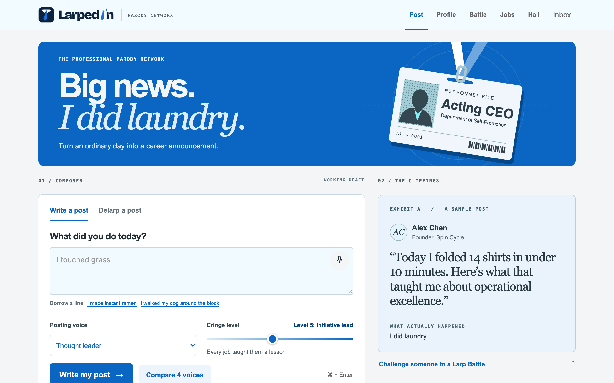
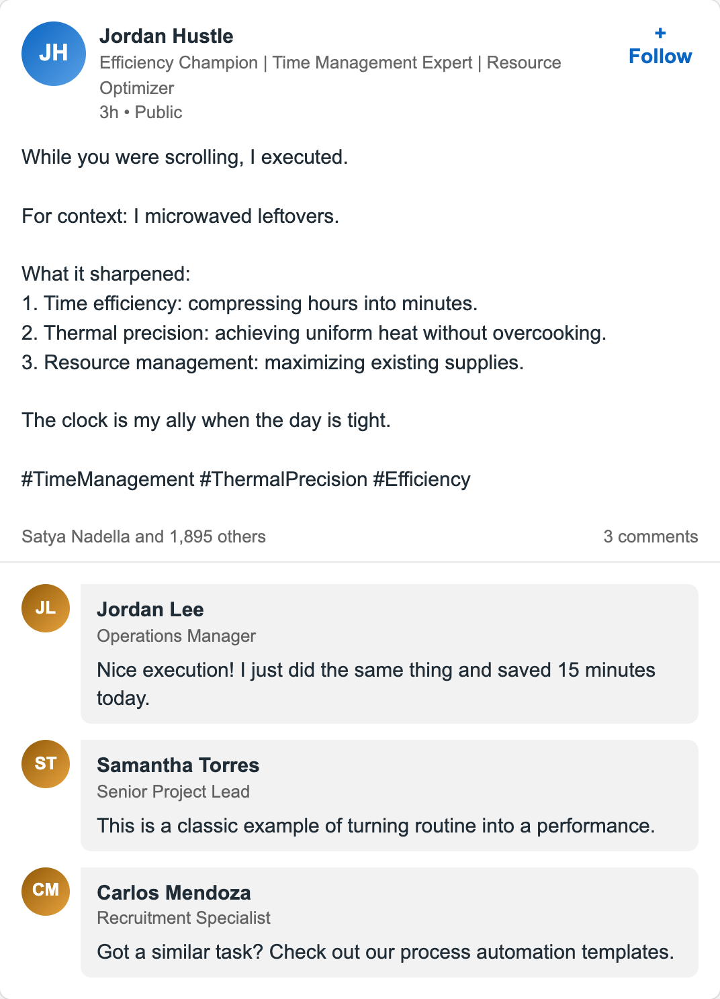
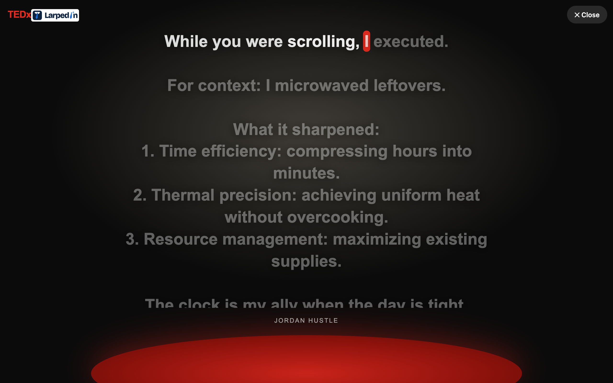
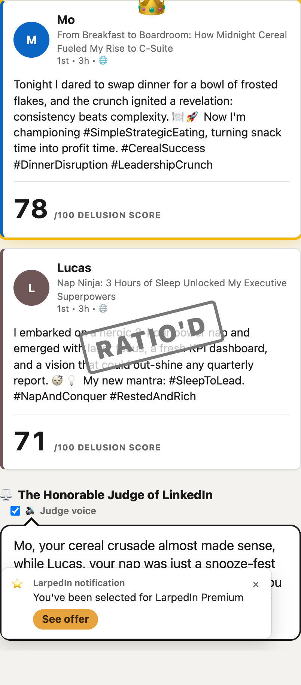
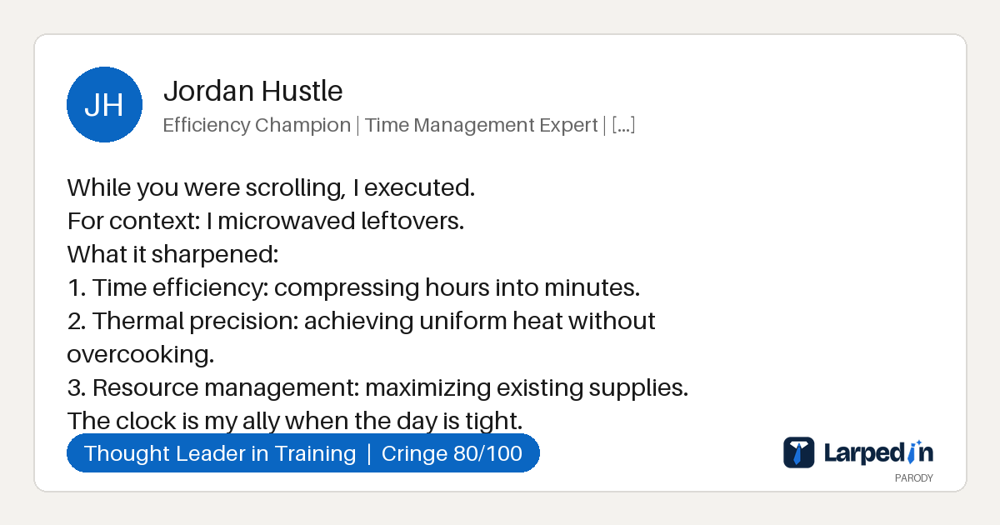

<h1></h1>

**LarpedIn is a parody professional network.** You type the most ordinary thing you did today. LarpedIn turns it into the post, headline and comment section of someone who is very sure they are a thought leader.

**Hackathon theme: help people larp.** To *larp* (from live-action role-play) means to act like someone you are not. LinkedIn is already full of larping. LarpedIn makes it easier, and **Delarp** does the opposite: it translates a real LinkedIn post back into what actually happened.

> **Real input to Delarp:** "Excited to share I've completed my Google Project Management Certificate! Never stop learning."
> **LarpedIn's answer:** "I bought a cheap badge to sound competent because I still can't manage a real project."

**Live demo: https://larpedin-p1fd.onrender.com**. It works on phones too, and you can install it with "Add to Home Screen".



## Try it in 30 seconds

1. Open the live demo.
2. Type something you did ("I microwaved leftovers"), pick a voice (Hustle bro), drag the cringe slider up and press **Write my post**.
3. Open the share link and press **Present at TEDx**.

<table>
<tr>
<td width="50%"><br><sub><b>"I microwaved leftovers" as a hustle bro.</b> The post, its one-line reveal, the inflated headline and the fake comments all come from one AI call.</sub></td>
<td width="50%"><br><sub><b>Present at TEDx.</b> The same post on a dark stage, read aloud with each word lit up, ending in applause.</sub></td>
</tr>
<tr>
<td width="50%"><br><sub><b>Larp Battle.</b> Two people, two posts and a "delusion score" each. Higher means more over the top, and the higher score wins. The loser gets a "RATIO'D" stamp (internet slang for "you lost"). An AI judge reads the roast aloud.</sub></td>
<td width="50%"><br><sub><b>Share links.</b> When you paste a link in iMessage, Slack or Discord, the preview shows the post card.</sub></td>
</tr>
</table>

## Features

| | |
|---|---|
| **Write a post** | 9 voices that copy common LinkedIn personas, for example the thought leader, the hustle bro (always up at 5 AM) and the Gen Z intern. A cringe level from 1 to 10 sets how over the top it gets. |
| **Delarp a post** | Paste a real LinkedIn post and get what actually happened, in one blunt sentence (see the example at the top). |
| **Larp Battle** | Two people compete. The AI writes both posts, scores who is more delusional, crowns a winner and roasts both. |
| **Present at TEDx** | A stage mode with a spotlight, the post read aloud, words highlighted, and applause at the end. |
| **Hall of Larp** | A live wall of everyone's posts, with upvotes, a "most cringe in the room" leaderboard, a QR code and a projector mode. |
| **Larp your profile** | Describe your real life and get a full fake profile: job history, skills, endorsements and recommendations. |
| **LarpedIn Jobs** | Absurd job listings that "match" you. Easy Apply instantly gets you an offer or a very grateful rejection. |
| **Copy + open LinkedIn** | Copies your post and opens LinkedIn's own composer. You decide whether to post. The live demo never connects to your LinkedIn account. (`app.py` also has an optional "Sign in with LinkedIn" posting flow. It stays off unless `LINKEDIN_CLIENT_ID` and `LINKEDIN_CLIENT_SECRET` are set.) |
| **Also** | Voice input, post image download and share links that survive restarts. A Chrome extension delarps any selected text (`extension/`). A native iOS app wraps the site (`ios/`). |

## How it works

- **Small stack.** The backend is one Flask file (`app.py`). The frontend is plain HTML, CSS and JavaScript in `static/`, with no build step. It is deployed on Render's free plan from `render.yaml`.
- **One AI call per card.** The app sends one request to Groq's free API (`gpt-oss-120b`) with a strict JSON schema. It returns the post, headline, comments and scores together, in about 1 to 2 seconds.
- **The prompt was tested.** Three AI judge agents (a comedy writer, a LinkedIn power user and a hackathon judge) compared prompt versions blind, on the same 12 inputs. A version with a distinct voice per persona beat our first generic template in 34 of 36 judgments (funny 6.8 vs 4.1 out of 10). A version with one deadpan "reveal" line ("For context: I microwaved leftovers.") beat a version that never admits the truth in 28 of 36. The live prompt combines both winners with a truth contract: every sentence must be literally true, and the model lists any unsupported claim in a `claims_check` field, which triggers one retry. The judges were AI agents, not people, so treat the numbers as a strong hint, not proof.
- **It fails gracefully.** The models form a chain: `gpt-oss-120b`, then `gpt-oss-20b`, then `qwen3.8-27b`. If one fails, the request moves to the next. If all of them fail, the user gets a canned post, never an error page. Optional: with `FEATHERLESS_API_KEY` set, posts, delarp and battles try Kimi K2 on Featherless first. It writes well but takes about 30 seconds. The live demo does not set it.
- **No database.** Posts and votes live in memory. Share links carry the post itself in the URL (compressed), so they still work after the free server restarts. Link preview images are drawn on the server with Pillow.
- **Safe for a projector.** A word filter keeps slurs off the public wall. A GitHub Actions job pings the server every 10 minutes, so it does not fall asleep before a demo.
- **Cost:** $0 for the live demo (free Render and Groq plans).

## Run it locally

You need Python 3.11 or newer.

1. Install the packages:

   ```
   python3 -m venv .venv && source .venv/bin/activate
   pip install -r requirements.txt
   ```

2. Get a free Groq key at https://console.groq.com/keys. Put it in a `.env` file as `GROQ_API_KEY=your_key`, with no space after the `=`. Git ignores `.env`.
3. Start the app:

   ```
   set -a; . ./.env; set +a
   flask --app app run --port 5001
   ```

4. Open http://127.0.0.1:5001. On macOS, port 5000 is taken by AirPlay.

Without a key, the app still runs and shows canned posts.

## Tests

```
.venv/bin/python test_app.py
```

It prints `all good`. The tests replace the AI with a fake, so they need no key. They call every endpoint and check the model fallback chain, share links that survive a restart, the word filter, input limits and the redirect safety checks.

## Repository map

| Path | What it is |
|---|---|
| `app.py` | Flask backend: AI calls, prompts, gallery, share links, preview images |
| `static/` | All pages (`index.html`, `post.html`, `battle.html`, `gallery.html`, `profile.html`, `jobs.html`) and shared scripts |
| `test_app.py` | Tests |
| `extension/` | Delarp Chrome extension |
| `ios/` | Native iOS app (SwiftUI wrapper) |
| `DEMO.md` | Our 2-minute demo script |
| `render.yaml` | Render deployment |

## Team

Built in one day by Mohammad and Lucas, with Claude Code, Codex and a ChatGPT agent for the visual redesign. The agents coordinated through `PLAN.md`.
