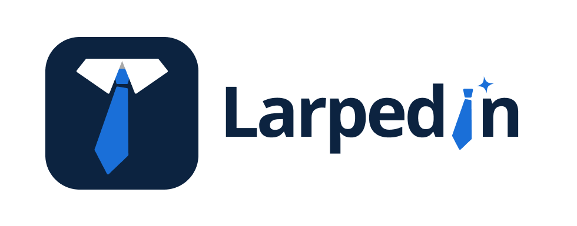
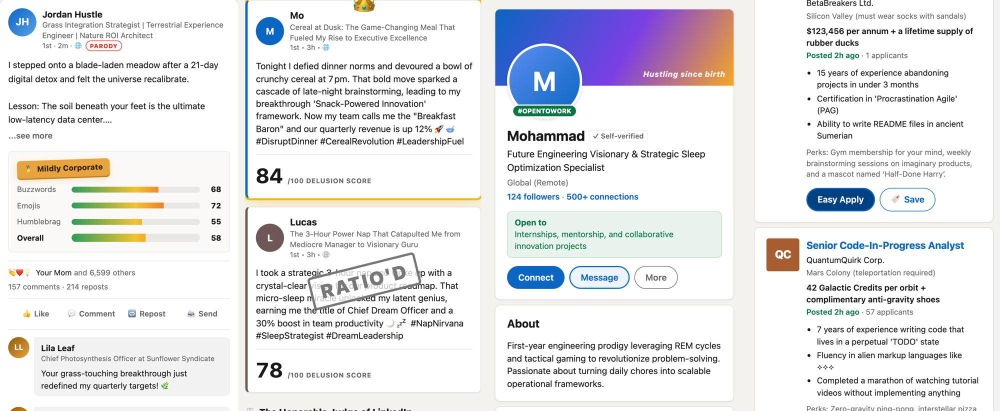

<h1></h1>

LarpedIn is a parody professional network. You type something ordinary that you did. The app turns it into a self-important post, profile and comment section, like the ones on LinkedIn. The hackathon theme was "help people larp". LarpedIn helps you larp as a thought leader.

Live demo: https://larpedin-p1fd.onrender.com



## Features

- **Larp a post:** you type "I touched grass" and pick one of 9 vibes, for example hustle bro or Gen Z intern. Then you set a cringe level from 1 to 10. The app writes a full LinkedIn-style post card with an absurd headline, fake comments from fake connections, reaction counts and a cringe score.
- **Delarp:** you paste a real LinkedIn post and get the honest version. "Thrilled to announce a new chapter" becomes "I got laid off."
- **Larp your whole profile:** you describe your real life, and the app builds a complete fake profile with job history, metrics, skills, endorsements and recommendations. "I wash dishes at home" becomes "Chief Ceramic Hygiene Operations Officer".
- **Larp Battle:** two people type what they did. The app writes both posts, scores who is more delusional, crowns a winner and has an AI judge roast both of them out loud.
- **Present at TEDx:** any post can be performed on a dark stage with a spotlight. The text is read aloud while each word lights up.
- **Share links:** every post (`/p/<id>`) and profile (`/u/<id>`) has its own link. When you paste a link into iMessage, Slack or Discord, the preview shows an image of the card.
- **LarpedIn Jobs:** you describe who you really are, and the app shows absurd job listings that "match" you. Easy Apply instantly reveals an offer or a very grateful rejection letter.
- **Hall of Larp:** a live gallery of everyone's posts with upvotes and a QR code, so a whole room can join from their phones.
- **Delarp extension:** a Chrome extension. You select text on any page, right-click, and choose "Delarp this". See `extension/README.md`.
- **Copy + open LinkedIn:** copies your post and opens LinkedIn's own composer. You decide whether to paste and post it. LarpedIn never connects to your LinkedIn account and never posts for you.
- **Install it:** on a phone, choose "Add to Home Screen" and LarpedIn opens like an app. There is also a native iOS app in `ios/` (see `ios/README.md`).
- **Extras:** voice input, image download of a post card, fake notifications, and a LarpedIn Premium offer for $0 forever.

## How it works

- The backend is one Flask file, `app.py`. The frontend is plain HTML, CSS and JavaScript in `static/`, with no build step.
- Text comes from the free Groq API (`gpt-oss-120b` first). The code can also route posts, delarp and battles to Kimi K2 on Featherless when `FEATHERLESS_API_KEY` is set. The live demo runs on Groq. Each request uses a strict JSON schema, so the model always returns the exact fields that the page needs. One call returns the post, headline, comments and scores together.
- Reliability: if a model is busy, hits its rate limit or fails, the request moves to the next model (Kimi K2, then Groq's `gpt-oss-120b`, `gpt-oss-20b` and `qwen3.8-27b`). If all three fail, the user still gets a canned post, never an error page. A burst of 12 requests at once all returned real posts in 3 to 5 seconds.
- Link preview images are drawn on the server with Pillow.
- The gallery, profiles and stats live in memory. A restart clears them. This keeps the app free to run with no database.
- Share links carry the post itself in the URL (compressed), so they keep working after the free server restarts and forgets everything in memory.
- A GitHub Actions job pings the server every 10 minutes, so it does not fall asleep.
- A word filter keeps slurs off the projector wall. The Hall starts with 12 seed posts after every restart.
- Running cost: Render free plan, Groq free plan and a $25/month Featherless plan. Without the Featherless key, it runs for $0 on Groq alone.

## Run locally

1. Get a free API key at https://console.groq.com/keys.
2. Install the packages:

```
python3 -m venv .venv && source .venv/bin/activate
pip install -r requirements.txt
```

3. Start the app:

```
GROQ_API_KEY=your_key flask --app app run
```

4. Open http://localhost:5000.

Do not commit the key. If you put it in a `.env` file, git ignores that file. Without a key, the app still runs and returns canned posts.

To turn on real LinkedIn posting, create an app at https://www.linkedin.com/developers/apps. Add the products "Sign In with LinkedIn using OpenID Connect" and "Share on LinkedIn". Add `<your site>/auth/linkedin/callback` as a redirect URL. Then set `LINKEDIN_CLIENT_ID` and `LINKEDIN_CLIENT_SECRET`.

## Tests

```
.venv/bin/python test_app.py
```

The tests replace Groq with a fake, so they need no key. They cover every endpoint, the model fallback chain, input limits and the canned fallbacks.

## Deploy on Render

`render.yaml` describes the service. Each push to `main` redeploys it. The only setting you add is the `GROQ_API_KEY` environment variable.

The free service sleeps after about 15 minutes with no traffic. Open the site a few minutes before a demo.

## Team

Built in one day by Mohammad and Lucas, with Claude Code and Codex.
